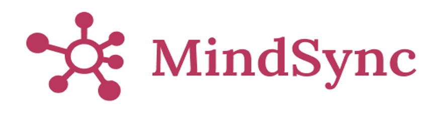

An AI based solution for information compression using mindmaps

## Overall Idea

Mindmapping is a visual brainstorming technique that involves creating diagrams to organize and structure information around a central concept. By using nodes or branches that radiate outward from a central idea, mindmapping allows for a more intuitive representation of complex information, promoting clarity and creativity. This technique is important because it facilitates the exploration of ideas, encourages connections between different concepts, and helps in problem-solving by visually mapping out relationships. Mindmapping is widely used in various fields, from education to business, as it provides a versatile and flexible approach to ideation, planning, and communication, enabling individuals and teams to harness their creativity and streamline their thought processes.

The platform aims to provide AI-based mindmapping solutions, encompassing text-to-mindmap, speech-to-mindmap, and video-to-mindmap functionalities. The goal is to offer intuitive and interactive mindmapping tools for users to brainstorm, organize, and visualize ideas across various mediums. The platform will also include a browser extension to facilitate mindmapping across different internet platforms. The intent is to streamline the mindmapping process for both casual users and professionals, enhancing productivity and creativity.

## The Problem

The following issues are the key problems this project addresses:

1. **Lack of Versatile Mindmapping Tools:** Traditional mindmapping tools are often limited to text-based inputs, restricting the creativity and flexibility of users.
2. **Inconvenient Workflows:** Existing tools require users to switch between different applications and formats, disrupting workflow and reducing efficiency.
3. **High Learning Curve:** Current mindmapping tools can be complex and difficult to use, deterring users who seek simple solutions for brainstorming and idea organization.
4. **Limited Integration with Other Platforms:** There is a lack of seamless integration with browsers and other platforms, complicating the use of mindmapping tools across different environments.

## The Solution

To address the aforementioned problems, the proposed platform offers the following solutions:

1. **Multiple Input Formats:** The platform supports text-to-mindmap, speech-to-mindmap, and video-to-mindmap, enabling users to select their preferred method for creating mindmaps.
2. **Browser Extension:** With the browser extension, users can access mindmapping capabilities from any website, facilitating on-the-fly brainstorming and note-taking.
3. **User-Friendly Interface:** The platform is designed with an intuitive interface, reducing the learning curve and encouraging widespread adoption.
4. **Integration with Other Tools:** The platform allows users to integrate with other applications, such as note-taking apps, project management tools, and more.

The following image may help to visualize the solution:

## Criteria

Comparison with Existence's project selection criteria:

1. **Alignment With Holistic Philosophy:**
   - The platform aligns with Existence's core philosophy of promoting creativity and productivity through innovative technology. It encourages users to think critically, creatively, and collaboratively.
2. **Open Source Compatibility:**
   - The platform can be designed with open-source components, allowing for community contributions and transparency in development. However, proprietary components might be required for paid tiers and specialized functionalities.
3. **Monetization Feasibility:**
   - The project has clear monetization pathways through a tiered subscription model. Tier 1 (speech-to-mindmap) and Tier 2 (video-to-mindmap) can generate revenue, while text-to-mindmap serves as a free entry point to attract users. Potential issues include competition from other platforms and the need to maintain unique value propositions.
4. **Research Facility:**
   - The project has a dedicated research side focusing on creating datasets and models. This side aims to produce research papers and consider patent opportunities, contributing to the AI and mindmapping knowledge base.
5. **Impact:**
   - The platform's impact can be substantial, improving productivity and creativity for individuals, teams, and organizations. By offering versatile mindmapping tools, the platform can facilitate better brainstorming, planning, and problem-solving.
|

## Contributors

Thanks goes to these wonderful people:
 

<table>
  <tr>
     <td align="center">
         <a href="https://github.com/itsskofficial">
             
            
               <b>
                  Sarthak Karandikar
               </b>
            
         </a>
          
            🧑🏻‍💼💻
      </td>
      <td align="center">
         <a href="https://github.com/Kabeer2004">
             
            
               <b>
                  Kabeer Ahmed Merchant
               </b>
            
         </a>
          
            🧑🏻‍💼💻
      </td>
      <td align="center">
         <a href="https://github.com/abhijeetsuryawanshi12">
             
            
               <b>
                  Abhijeet Suryawanshi
               </b>
            
         </a>
          
            💻
      </td>
      <td align="center">
         <a href="https://github.com/ojaswini1410">
             
            
               <b>
                  Ojaswini Prabhune
               </b>
            
         </a>
          
            🎨
      </td>
      <td align="center">
         <a href="https://github.com/varaddeshpande15">
             
            
               <b>
                  Varad Deshpande
               </b>
            
         </a>
          
            💻
      </td>
  </tr>
</table>

## License

Open Core distributed under the GNU-GPL License. See [Open Core License](LICENSE.md) for more information.

## Code of Conduct

Please review our [Code Of Conduct](CODE_OF_CONDUCT.md) to maintain a rightful atmosphere in the club

## Contributing

Contributions are welcome! Check our [Contributing Guide](CONTRIBUTING.md) to start contributing to MindSync
